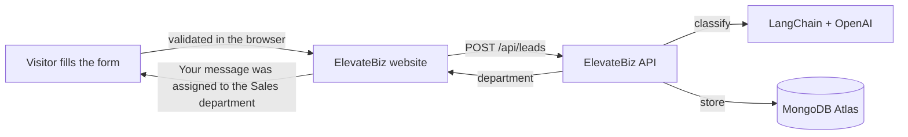

# ElevateBiz — AI Automation & Marketing Landing Page

Bilingual (English / Spanish) marketing site for **ElevateBiz**, an agency that helps small and medium businesses automate customer service, lead handling, and marketing with AI.

**Live site:** [elevatebiz.ai](https://elevatebiz.ai)
**Backend:** [ElevateBiz API](https://github.com/AntonioGlUs/elevatebiz-api) (FastAPI + LangChain + MongoDB)

## How the contact form works

The contact form is connected to the ElevateBiz API, which classifies every request with AI:



1. The visitor fills out the form. Name and email are validated in the browser first, with inline, accessible error messages.
2. The site sends the lead to the API at `https://api.elevatebiz.ai/api/leads`.
3. The API uses AI to pick the **department** (sales, support, partnerships), set an **urgency**, and write a short **summary**, then saves the lead in MongoDB.
4. The site tells the visitor which department their message was assigned to (in the visitor's language). Urgency and summary stay internal for the team.

## Tech stack

- [Next.js 14](https://nextjs.org) (App Router) with static export
- React 18 + TypeScript
- CSS Modules (one stylesheet per component)
- [Three.js](https://threejs.org) for the interactive 3D robot
- Google Fonts (Fraunces, Karla)
- No UI framework: layout, styles, and animations are hand-built

## Features

### Landing page

- **Hero that follows the time of day.** A full-screen storefront photo with a neon "Open 24 Hours" sign. The visitor's local hour picks the daytime photo (07:00 to 16:59) or the dusk one. Add `?time=day` or `?time=night` to the URL to preview either.
- **Navigation.** A transparent bar with a centered pill menu over the hero that turns into a solid bar on scroll. When the screen gets narrower the menus fold into a "More" dropdown in stages, and finally into the ☰ menu. Only one dropdown is open at a time.
- **Announcement ribbon.** Slides in from the top 3 seconds after the page loads and can be closed.
- **Curved 3D services carousel.** Five cards in an arc; the middle one widens, lifts and shows a "See more ↗" link when hovered. It scrolls when the mouse is over the side cards, with the arrows, by dragging or swiping, and with the keyboard. Each card links to a detail page (for now the coming-soon page).
- **Stats band.** Three compact cards (18 hrs, 24/7, <5 min) that count up when they come into view, over a background image with a horizontal parallax effect.
- **Mission section** with the interactive 3D robot (Three.js, loaded on demand and only animating while on screen).
- **Animated WhatsApp demo.** A scripted conversation plays message by message with a typing indicator, showing how an AI assistant answers a customer.
- **Lead-routing diagram.** An animated diagram shows incoming leads being routed to the right team member by specialty.
- **FAQ cards.** Six cards of the same height; clicking anywhere on a card opens its answer.
- **Testimonial, contact form, call-to-action band and footer.** The logo band shows placeholder circles for the portfolio.
- **AI chatbot.** An n8n-powered chat widget (`Chatbot.tsx`) answers visitors' questions.
- **Preview notice.** A small card in the corner explains which features are switched off until launch (see `ACTIONS_ENABLED` in `app/components/constants.ts`).

### Language, forms and accessibility

- **EN / ES language toggle.** All copy lives in one typed content file (`lib/content.ts`). The site picks the browser's language the first time, remembers the choice, and keeps `<html lang>` in sync.
- **Accessible form validation.** Inline error messages in EN/ES, `aria-invalid` / `aria-describedby` for screen readers, a visible message when sending fails, and focus moves to the first invalid field.
- **Respects reduced motion** in the parallax and hero effects.

### Demo site: Riverdale Dental Care

A fictional dental clinic website at `/demos/dental`, built to show what ElevateBiz can deliver for a local business:

- Full-width team banner, services menu with a photo that changes on hover, patient reviews, team, and contact footer
- A simulated booking flow (nothing is saved)
- A "Back to ElevateBiz" button that is always visible

### Performance and hosting

- **Optimized images.** WebP, sized for their display size, with lazy loading below the fold.
- **Link previews.** Open Graph and X (Twitter) card metadata.
- **Static export.** `next build` outputs plain HTML/CSS/JS to `out/`, so the site runs on any static or shared hosting (no Node.js server needed).

## Getting started

Requires Node.js 18+.

```bash
npm install
npm run dev
```

Open [http://localhost:3000](http://localhost:3000).

The contact form calls the production API by default. To test against a local copy of the API, change `API_URL` in `app/components/constants.ts` to `http://localhost:8000`.

### Production build

```bash
npm run build
```

The static site is generated in `out/` and can be uploaded to any web host.

## Project structure

```
app/
  layout.tsx       — metadata (including link previews), fonts, favicon
  page.tsx         — page layout: the order of the sections, language, announcement ribbon
  globals.css      — base styles and responsive overrides
  components/      — one component per section, each with its own .module.css
    ContactForm.tsx  — form, validation, and the call to the API
    Hero.tsx         — time-of-day hero photo
    NavBar.tsx       — navigation with the "More" menu
    ServicesCarousel.tsx — curved 3D carousel
    StatsBand.tsx    — stat cards with parallax background
    Robot3D.tsx      — interactive Three.js robot
    constants.ts     — API URL, preview-mode switch, and shared links
  demos/
    dental/          — the Riverdale Dental Care demo site
lib/
  content.ts       — EN/ES copy, stats, FAQ, team, navigation, chat script
public/
  images/          — WebP images and logo (dental/ holds the demo's photos)
  coming-soon/     — placeholder page for links that aren't live yet
```

## Roadmap

- [x] Connect the contact form to the AI lead classification API
- [x] Embed an AI chat widget
- [x] Visual redesign of every section
- [x] Demo site for a dental clinic
- [ ] Night version of the hero photo (the dusk one is used after 17:00 for now)
- [ ] Detail pages for each service (the carousel links to the coming-soon page)
- [ ] Replace placeholder client logos and the testimonial with real ones
- [ ] Cloudflare Turnstile on the contact form (bot protection)
